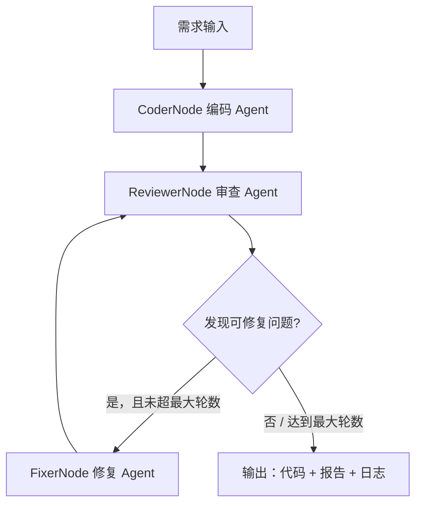

# 代码审查 Workflow（Simple Workflow MVP）

一个用 **纯 Python 标准库** 实现的「多 Agent 协作 Workflow」，把自然语言需求经过
**编码 → 审查 → 修复** 三步协作，最终产出通过审查的代码。

> 课程作业 **Homework 2**：搭建一个 2-3 个 Agent 协作的简单 Workflow，理解
> Workflow 编排、Agent 间通信、状态管理等核心概念。

---

## 一、项目简介

本项目选择作业的 **「代码审查流程」** 方向，用 **3 个 Agent** 协作完成端到端流程：

| 节点 | 角色 | 输入 → 输出 |
|------|------|------------|
| **CoderNode** 编码 Agent | 把自然语言需求写成代码 | 需求 → 代码 |
| **ReviewerNode** 审查 Agent | 审查代码（**复用 HW1 的 CodeReviewAgent**） | 代码 → 问题清单 + 审查报告 |
| **FixerNode** 修复 Agent | 根据问题清单自动修复代码 | 代码 + 问题清单 → 修复后的代码 |

核心能力：

- ✅ **多 Agent 协作**：3 个 Agent 通过共享状态接力完成一个完整流程
- ✅ **Agent 间通信**：共享 `WorkflowState`（状态共享）+ 执行日志（消息传递）
- ✅ **流程控制**：顺序执行 + 条件分支（有问题才修复）+ 循环（修复后重新审查）
- ✅ **执行日志与状态追踪**：每个节点的 start / finish / retry / error 全程记录
- ✅ **错误处理与恢复**：节点异常自动重试一次，修复无进展时主动终止（防死循环）
- ✅ **复用 HW1**：审查节点直接复用 Homework1 的代码审查 Agent
- ✅ **离线 Mock**：不填 API key 也能完整跑通，且修复闭环真实收敛

## 二、流程概览



> 若 GitHub 不渲染 Mermaid，见 [Design.md](./Design.md) 中的 ASCII 流程图。

## 三、目录结构

```
code-review-workflow/
├── run.py                  # 启动入口：python run.py <需求>
├── config.example.json     # 配置文件示例（填 API key 后改名 config.json）
├── requirements.txt        # 零第三方依赖说明
├── README.md               # 本文件：项目说明与使用手册
├── Design.md               # 设计文档：架构、编排、状态管理、关键决策
├── agent/                  # ★ 复用 HW1 的代码审查 Agent（作为审查节点）
│   ├── __init__.py
│   ├── prompts.py          # prompt 设计
│   ├── llm.py              # LLM Provider 抽象（+ 新增 complete_text 文本生成接口）
│   ├── tools.py            # 工具集 + 静态分析器（+ 新增 kind 字段与 analyze_source）
│   ├── memory.py           # 上下文记忆
│   └── core.py             # CodeReviewAgent（ReAct 核心循环）
├── workflow/               # ★ 本作业新增：Workflow 编排层
│   ├── __init__.py
│   ├── state.py            # 共享状态（Agent 间通信的数据总线）
│   ├── nodes.py            # Workflow 节点抽象 + 编码/审查/修复三个 Agent
│   ├── engine.py           # Workflow 引擎（顺序 + 条件 + 循环 + 日志 + 错误恢复）
│   ├── main.py             # 命令行入口
│   └── webapp.py           # 可视化执行界面（可选）
├── examples/
│   └── requirements.txt    # 示例需求
└── tests/
    └── test_workflow.py    # 单元测试
```

## 四、快速开始（离线演示，无需 API key）

环境要求：**Python 3.6+**，无需安装任何第三方库。

```bash
cd code-review-workflow

# 跑完整 Workflow（内置 Mock 模式，离线即可运行）
python run.py "写一个把列表里所有数字相加的函数"

# 打印每个节点 + 每一步推理过程（可看到审查节点里的 ReAct 循环）
python run.py "写一个计算平均值的函数" --verbose

# 最多修复 5 轮（默认 3 轮）
python run.py "..." --max-rounds 5

# 把执行结果（含代码、报告、日志）保存为 JSON
python run.py "..." -o result.json
```

输出示例（摘要）：

```
状态：成功
修复轮数：1
最终问题数：0（严重 0 个）

--- 修复记录 ---
  * 把裸 except 改为 except Exception（第 21 行）
  * 把 == None 改为 is None（第 8 行）
  * 修复可变默认参数 items（第 7 行）
  * 移除硬编码密钥（第 4 行）
  * 删除未使用的导入（第 2 行）

--- 执行日志（消息传递记录） ---
  [coder] finish 编码完成，产出 22 行代码
  [reviewer] finish 审查完成：发现 5 个问题（严重 1 个）
  [fixer] finish 已修复 5 处问题
  [reviewer] finish 审查通过：未发现问题
```

## 五、可视化界面（可选）

```bash
python run.py "写一个处理数据的函数" --web
# 浏览器打开 http://127.0.0.1:8001
```

页面会把「编码 → 审查 → 修复 → 再审查」渲染成一条流水线，并展示最终代码、
审查报告、修复记录与执行日志。

## 六、接入真实 LLM

复用 HW1 的 Provider 抽象，支持 OpenAI / 通义千问（DashScope）等兼容接口。

1. 复制配置模板：

   ```bash
   cp config.example.json config.json
   ```

2. 填入 API key，设置 `provider`（如 `dashscope`）：

   ```json
   {
     "provider": "dashscope",
     "dashscope": {
       "base_url": "https://dashscope.aliyuncs.com/compatible-mode/v1",
       "api_key": "sk-你的通义千问密钥",
       "model": "qwen-plus"
     }
   }
   ```

3. 运行：

   ```bash
   python run.py "写一个登录函数" --config config.json
   ```

> 未配置 key 时自动回退到 Mock 模式，保证任何时候都能跑。
> 真实 LLM 模式下：编码/修复节点用 `complete_text` 生成文本，审查节点复用
> HW1 的 `CodeReviewAgent`（结构化决策）。

## 七、单元测试

```bash
python -m unittest discover -s tests -v
```

## 八、如何扩展（可扩展性）

- **新增一个 Agent**：继承 `workflow.nodes.WorkflowNode`、实现 `run(state)`，
  用 `@register` 注册到 `NODES`，引擎无需改动；
- **替换节点**：`WorkflowEngine(coder, reviewer, fixer, ...)` 传入自定义节点即可；
- **换 LLM 服务商**：实现 `agent.llm.LLMProvider` 的 `complete` / `complete_text`。

详见 [Design.md](./Design.md) 第 5 节。

## 九、打包提交

按作业要求，把整个目录打包为「学号姓名」命名的压缩包：

```bash
# 以学号 2412190722、姓名 尹鸿玮 为例
zip -r "2412190722-计科2403尹鸿玮-HW2.zip" code-review-workflow
```

压缩包内容 = ① 源代码（本项目）② 文档（README.md / Design.md）。
演示视频为可选项，需另外录制（≤ 1 分钟）。
